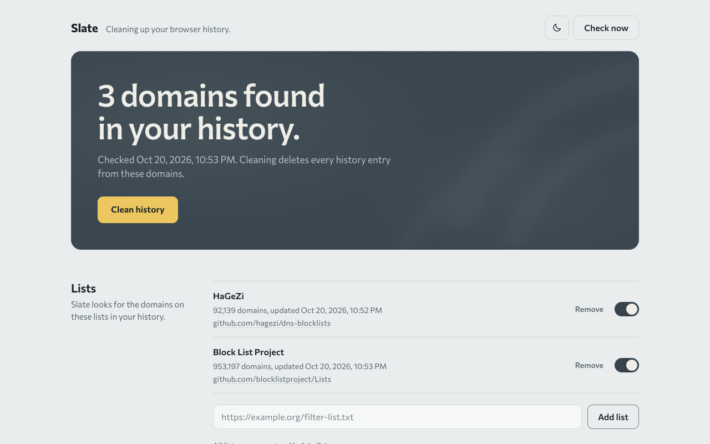

<h1>
  Slate
  <a href="https://github.com/ari92p/slate/releases/latest">
    
  </a>
</h1>

Slate is a discreet browser extension for Chromium-based browsers. It checks the current browser profile against curated domain lists and removes matching history entries with one click. Matching cookies can be removed optionally. The interface is in English and supports light and dark appearance with a circular theme transition.



## Features

- One-click cleanup from the extension icon
- Individually switchable lists from HaGeZi and Block List Project
- Visible source links, removal and restoration of bundled lists
- Custom HTTPS filter lists with their own update status
- Your own rules: domains to always clean and domains to never clean (takes priority)
- Optional cookie cleanup with optional permissions
- Manual, hourly, six-hourly or daily checks
- Local processing without analytics
- The toolbar icon shows the state as a small slate: chalk writing means matches, a tick means clean. No counter badge

## Installation from a GitHub release

1. Open the repository's [Releases](https://github.com/ari92p/slate/releases) page.
2. Download and extract the latest ZIP.
3. Open `brave://extensions` or `chrome://extensions`.
4. Enable **Developer mode**.
5. Choose **Load unpacked** and select the extracted folder.

Keep the extracted folder in place because the browser loads the extension directly from it.

## Installation from source

Clone this repository, open the browser's extension page, enable Developer mode and load the repository folder as an unpacked extension.

## Usage

Click the Slate icon to clean matching history entries. Open the icon's context menu and choose **Slate: Settings and status** to manage scans, lists, cookie cleanup and your own rules.

Cookie cleanup is disabled by default. Enabling it triggers the browser's permission prompt and may sign you out of matching sites.

## Privacy and limitations

History, cookies and custom rules are processed locally. Public and user-added lists are downloaded from their configured provider, which receives normal connection data such as the IP address. Slate does not use analytics or transmit browser data. See [PRIVACY.md](PRIVACY.md) for details.

Public lists can contain errors and cannot cover every site. Slate does not clear cache, Local Storage, downloads, bookmarks, open tabs or other browser profiles. Deletion cannot be undone.

## Development

Node.js 22 or newer is required. No package installation is needed.

```sh
npm test
npm run build
```

The toolbar and extension icons in `icons/` are generated from `scripts/build-icons.mjs`. After changing the icon design, run `node scripts/build-icons.mjs` with a Chromium-based browser installed.

`npm run build` keeps only the current build in `dist/`: the release ZIP `dist/slate-v<version>.zip` (version from `manifest.json`) and the unpacked folder `dist/slate/`. Load `dist/slate/` once with **Load unpacked**; after later builds, click the extension's reload button instead of adding it again.

## Third-party lists, code and licenses

- [HaGeZi DNS Blocklists](https://github.com/hagezi/dns-blocklists), GPL-3.0
- [Block List Project](https://github.com/blocklistproject/Lists), Unlicense; the delivered list header also mentions MIT
- [Circular Theme Switch](https://github.com/ari92p/circular-theme-switch) v1.1.3, bundled in `vendor/`, MIT
- [Commissioner](https://github.com/kosbarts/Commissioner) typeface, bundled in `fonts/`, SIL Open Font License 1.1

License texts and attribution are included in [`licenses/`](licenses/), [`vendor/`](vendor/) and [`fonts/`](fonts/). Slate's original source code is licensed under the [MIT License](LICENSE).
