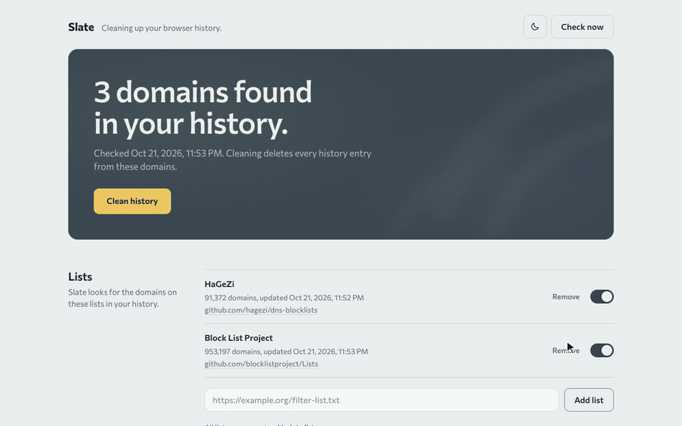

<h1>
  Slate
  <a href="https://chromewebstore.google.com/detail/slate/hcgiidknjjdnjcmedheaiokjpcabenmb">
    
  </a>
  <a href="https://github.com/ari92p/slate/releases/latest">
    
  </a>
</h1>

Slate is a discreet extension for Chromium-based browsers such as Chrome and Brave. Browsers let you keep your whole history or wipe it; Slate removes only the sites you choose. You decide what gets cleaned with your own block and allow lists and with filter lists, and Slate removes matching history entries with one click. Two public curated filter lists are included as a ready-made start. Matching cookies can be removed too, if you turn that on. Everything runs locally in your browser: no account, no server, no analytics.



## Features

- Your own rules: a block list of domains to always clean, and an allow list of domains to never clean, which takes priority
- Filter lists: subscribe to any HTTPS filter list, the same kind used by DNS and content blockers, each with its own update status
- Bundled lists from HaGeZi and Block List Project for adult content, each switchable, removable and restorable
- One-click cleanup from the toolbar icon; the icon shows the state as a small slate (chalk writing means matches, a tick means clean) without a counter badge
- Recognizes new matching visits as they happen, including pages that redirect elsewhere
- Also removes the address bar suggestions the browser learned for the start pages of cleaned sites
- Optional cookie cleanup, with permissions requested only when you turn it on
- Checks at browser start or hourly, every 6 or 12 hours, or daily
- Light and dark appearance

## Installation from the Chrome Web Store

Install Slate from its [Chrome Web Store page](https://chromewebstore.google.com/detail/slate/hcgiidknjjdnjcmedheaiokjpcabenmb). This works in Chrome, Brave and other Chromium-based browsers, and updates arrive automatically.

## Installation from a GitHub release

1. Open the repository's [Releases](https://github.com/ari92p/slate/releases) page.
2. Download and extract the latest ZIP.
3. Open `brave://extensions` or `chrome://extensions`.
4. Enable **Developer mode**.
5. Choose **Load unpacked** and select the extracted folder.

Keep the extracted folder in place because the browser loads the extension directly from it.

## Installation from source

Clone this repository, open the browser's extension page, enable Developer mode and load the repository folder as an unpacked extension.

## Usage

Click the Slate icon to clean matching history entries. Open the icon's context menu and choose **Slate: Settings and status** to manage scans, lists, cookie cleanup and your own rules.

Cookie cleanup is disabled by default. Enabling it triggers the browser's permission prompt and may sign you out of matching sites.

## Privacy and limitations

History, cookies and custom rules are processed locally. Public and user-added lists are downloaded from their configured provider, which receives normal connection data such as the IP address. Slate does not use analytics or transmit browser data. See [PRIVACY.md](PRIVACY.md) for details.

Public lists can contain errors and cannot cover every site. Slate does not clear search queries, cache, Local Storage, downloads, bookmarks, open tabs or other browser profiles. Deletion cannot be undone.

Browsers do not show extensions every history entry: visits synced from other devices and the starting pages of redirects are left out of the history API. Slate catches new ones as they happen, but entries that existed before Slate was installed can stay hidden from it. Install Slate on your other devices too, so their visits are cleaned at the source. A leftover address bar suggestion can be removed with its **Remove suggestion** button (×).

## Development

Node.js 22 or newer is required. No package installation is needed.

```sh
npm test
npm run build
```

The toolbar and extension icons in `icons/` are generated from `scripts/build-icons.mjs`. After changing the icon design, run `node scripts/build-icons.mjs` with a Chromium-based browser installed.

`npm run build` keeps only the current build in `dist/`: the release ZIP `dist/slate-v<version>.zip` (version from `manifest.json`) and the unpacked folder `dist/slate/`. Load `dist/slate/` once with **Load unpacked**; after later builds, click the extension's reload button instead of adding it again.

## Support

If this extension is useful to you, you can buy me a coffee:

<p>
  <a href="https://ko-fi.com/ari92p"></a>
  <a href="https://buymeacoffee.com/ari92p"></a>
</p>

## Third-party lists, code and licenses

- [HaGeZi DNS Blocklists](https://github.com/hagezi/dns-blocklists), GPL-3.0
- [Block List Project](https://github.com/blocklistproject/Lists), Unlicense; the delivered list header also mentions MIT
- [Circular Theme Switch](https://github.com/ari92p/circular-theme-switch) v1.1.3, bundled in `vendor/`, MIT
- [Commissioner](https://github.com/kosbarts/Commissioner) typeface, bundled in `fonts/`, SIL Open Font License 1.1

License texts and attribution are included in [`licenses/`](licenses/), [`vendor/`](vendor/) and [`fonts/`](fonts/). Slate's original source code is licensed under the [MIT License](LICENSE).
